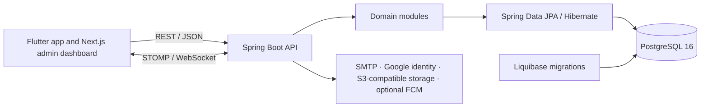

# GenLink KH Backend

The Spring Boot backend for GenLink KH, a Khmer-first super-app for Cambodia's Gen Z.

## About GenLink KH

GenLink brings community, personal growth, productivity, finance, and campus and event services into one mobile experience. This backend provides APIs for the mobile app and admin dashboard, plus real-time and third-party integrations.

## Technology Stack

| Area | Technologies |
|---|---|
| Language and build | Java 21, Gradle 8.14.3 wrapper |
| Application | Spring Boot 3.3.5, Spring MVC, Bean Validation, Spring Actuator |
| Persistence | Spring Data JPA, Hibernate, PostgreSQL 16, Liquibase |
| API and security | REST, Spring Security, JJWT 0.12.5, Bucket4j 8.10.1, springdoc OpenAPI / Swagger UI 2.5.0 |
| Real-time and cache | Spring WebSocket with STOMP, Spring Cache with in-memory caches |
| Integrations | Google API Client 2.7.0, Spring Mail / SMTP, Firebase Admin 9.10.0 for optional FCM, AWS SDK v2 2.28.16 for S3-compatible storage |
| Code generation | MapStruct 1.5.5.Final, Lombok |
| Tests and coverage | JUnit 5, Spring Boot Test, Spring Security Test, H2, JaCoCo |
| Build and deployment | Docker, Docker Compose, GitHub Actions, Nginx, AWS EC2 |

Spring Boot manages versions for dependencies that are not pinned in `build.gradle`. The S3 client can connect to compatible storage providers such as AWS S3, DigitalOcean Spaces, Cloudflare R2, or MinIO.

## Architecture

GenLink uses a **Modular Monolith** architecture. The backend runs as one Spring Boot application, with code grouped into domain modules. Modules share the same process and PostgreSQL database.



Most domain modules organize HTTP controllers, services, repositories, entities, and DTOs by feature. Spring Security handles authentication and authorization across the API. Shared code provides configuration, error handling, localization, security utilities, and WebSocket support.

## Project Structure

Java package root: `src/main/java/kh/edu/acleda/campuslink/`

```text
backend/
├── src/main/java/kh/edu/acleda/campuslink/
│   ├── GenlinkKhApplication.java
│   ├── modules/
│   │   ├── admin/           # Admin portal, roles, moderation, analytics
│   │   ├── auth/            # Sign-in, registration, OTP, tokens
│   │   ├── bff/             # Aggregated app responses
│   │   ├── community/       # Posts, discussions, groups, events
│   │   ├── entertainment/   # Quizzes, challenges, badges, XP
│   │   ├── finance/         # Wallets, budgets, income, financial literacy
│   │   ├── media/           # Media records and object storage
│   │   ├── mobile/          # Mobile app endpoints
│   │   ├── notification/    # In-app and external notifications
│   │   ├── productivity/    # Habits, tasks, deadlines, reminders
│   │   ├── profile/         # Profiles and preferences
│   │   ├── search/          # Search and discovery
│   │   ├── security/        # Sessions and account security
│   │   └── user/            # User records and lifecycle
│   ├── shared/              # Config, security, errors, localization, web, WebSocket
│   └── infrastructure/     # Cross-module persistence support
├── src/main/resources/
│   ├── application*.yaml   # Default, dev, and production configuration
│   ├── db/changelog/        # Liquibase schema changes and seed data
│   └── templates/email/     # Email templates
├── src/test/java/          # Automated tests
├── docs/                   # Backend feature and development guides
├── build.gradle
├── Dockerfile
├── docker-compose.yml
├── gradlew / gradlew.bat
└── settings.gradle
```

## Run Locally

### Prerequisites

- JDK 21
- Docker Desktop or Docker Engine

### 1. Start PostgreSQL

Run this once to create a local PostgreSQL 16 container. The database and credentials match the development profile defaults in `application-dev.yaml`.

```sh
docker run --name genlink-postgres-dev -e POSTGRES_DB=db_name -e POSTGRES_USER=db_user -e POSTGRES_PASSWORD=password -p 127.0.0.1:5435:5432 -d postgres:16-alpine
```

Wait until PostgreSQL is ready:

```sh
docker exec genlink-postgres-dev pg_isready -U db_user -d db_name
```

On later runs, start the existing container with:

```sh
docker start genlink-postgres-dev
```

### 2. Start the backend

Run these commands from the `backend/` directory.

**Windows PowerShell**

```powershell
.\gradlew.bat bootRun
```

**macOS or Linux**

```sh
./gradlew bootRun
```

The default profile is `dev`. Liquibase applies database migrations during startup.

### 3. Open the API

- API: `http://localhost:8888`
- Swagger UI: `http://localhost:8888/swagger-ui`
- OpenAPI schema: `http://localhost:8888/v3/api-docs`
- Health: `http://localhost:8888/actuator/health`

Press `Ctrl+C` to stop the backend. Stop the database container with `docker stop genlink-postgres-dev` when finished.

### Local configuration

The dev profile uses these PostgreSQL defaults:

| Variable | Default                                    |
|---|--------------------------------------------|
| `DB_URL` | `jdbc:postgresql://localhost:5435/db_name` |
| `DB_USERNAME` | `db_user`                                  |
| `DB_PASSWORD` | `password`                                 |

Set these environment variables before running Gradle if you use a different local database. Email delivery is disabled by default in development; OTP messages appear in the application logs. Google sign-in, S3 media storage, SMTP delivery, and mobile push need their corresponding credentials. Dev JWT and admin encryption keys are generated temporarily when unset, so tokens and encrypted admin credentials do not persist across restarts.

## Developers

| Name                | Role                 | GitHub                                  |
|---------------------|----------------------|-----------------------------------------|
| Ren Makara          | Full Stack Developer | https://github.com/RenMakara |
| Heng Chansela       | Full Stack Developer | https://github.com/TommmyBoizzz|
| Sokny Enat          | Full Stack Developer | https://github.com/E-Nat|
| Chhaeng Sokuntheara | Full Stack Developer | https://github.com/rabengbek|
