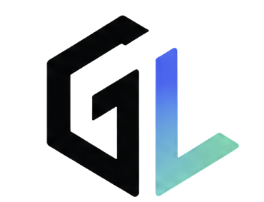

<div align="center">



# GenLink KH

**A Khmer-first Gen Z super-app — community, growth, and everyday life in one place.**

[](#-technology-stack)
[](#-technology-stack)
[](#-technology-stack)
[](#-technology-stack)
[](#-license)

</div>

---

## 📖 Project Overview

### What is GenLink KH?

**GenLink KH** is a mobile **super-app** built for Cambodia's Gen Z. It brings the parts of daily digital life that are usually scattered across a dozen apps — a social community, self-improvement and gamification, productivity, personal finance, and campus/event utilities — into a single, Khmer-first experience.

The app is designed **Khmer-first**: the interface follows the device language, defaulting to English but switching to Khmer automatically when the user's device is set to Khmer.

### Vision & Goals

- **One app, many needs** — reduce app fatigue by unifying the tools a young Cambodian actually uses every day.
- **Localized by default** — first-class Khmer language support, not an afterthought translation.
- **Growth-oriented** — turn everyday actions into progress through XP, levels, badges, and challenges.
- **Financially literate** — make budgeting and financial education approachable for a generation entering the workforce.
- **Production-grade** — a real, deployable product with proper security, CI/CD, and observability.

### Why We Built This

Young Cambodians juggle separate apps for chatting, learning, budgeting, staying productive, and following campus life — most of them English-only and none built for the local context. GenLink KH exists to close that gap with a single, cohesive, Khmer-first platform that treats a Cambodian Gen Z user as the primary audience rather than an edge case.

---

## ✨ Features

GenLink KH is organized into focused domains, each backed by its own module in the codebase.

### 🤝 Community

The social core of the app.

| Capability | Description |
|---|---|
| Posts & Feed | Create, like, and browse a personalized feed |
| Discussions | Threaded forum discussions with reactions and reports |
| Follows | Follow users, manage follow requests, privacy-aware |
| Communities | Join/leave groups with owner/admin roles |
| Opportunities | Browse jobs, scholarships, and opportunities (admin-curated) |
| Hashtags | Trending tags and content discovery |

### 🎮 Entertainment & Gamification

Turns engagement into measurable progress.

| Capability | Description |
|---|---|
| XP & Levels | Earn experience and level up through activity |
| Badges | Unlock achievement badges |
| Daily Challenges | Rotating challenges that reward participation |
| Quizzes | Interactive quizzes with scoring |
| Leaderboards | Compete on ranked leaderboards |
| Short Content | Short-form content with likes and saves |

### 🌱 Lifestyle & Productivity

Tools to build better habits and stay organized.

| Capability | Description |
|---|---|
| Habits | Track daily habits and check-ins |
| Deadlines & Tasks | Manage personal deadlines and to-dos |
| Motivation | Daily motivational content |
| Growth | Personal development tracking |

### 💰 Finance & Financial Literacy

Approachable money management and education.

| Capability | Description |
|---|---|
| Budgeting | Track income and expenses |
| Financial Literacy | Structured lessons with progress tracking |
| Insights | Personal finance summaries via the mobile BFF |

### 🎟️ Utility & Event Services

Everyday campus and community utilities.

| Capability | Description |
|---|---|
| Events | Create and browse events with pricing and RSVP |
| Notifications | In-app notification system |
| Profiles & Portfolio | Public profiles, portfolio items, interests, social links |

### 🔐 Authentication & System Features

| Capability | Description |
|---|---|
| Email + Password | Registration with email OTP verification |
| Google Sign-In | Firebase-free Google authentication |
| Password Recovery | OTP-based forgot/reset password |
| Account Lifecycle | Soft-delete with a 30-day grace period and automatic anonymization |
| Localization | Automatic Khmer/English based on device language |

---

## 🛠️ Technology Stack

### Frontend

| Technology | Purpose |
|---|---|
| **Flutter** | Cross-platform mobile framework |
| **GetX** | State management, routing, dependency injection, and i18n |
| **Dio** | HTTP client with interceptors and token refresh |
| **flutter_secure_storage** | Encrypted local token storage |
| **google_sign_in** | Google authentication |
| **device_info_plus** | Device metadata for session tracking |

### Backend

| Technology | Purpose |
|---|---|
| **Spring Boot 3.3.5** | Application framework |
| **Java 21** | Language runtime |
| **Spring Data JPA / Hibernate** | Persistence layer |
| **Liquibase** | Versioned database migrations |
| **Gradle** | Build tooling |
| **springdoc / Swagger UI** | API documentation |

### Database

| Technology | Purpose |
|---|---|
| **PostgreSQL 16** | Primary relational database |

### Deployment

| Technology | Purpose |
|---|---|
| **Docker Compose** | Container orchestration (app + database) |
| **Nginx** | Reverse proxy and single public entry point |
| **DigitalOcean** | Cloud hosting (Ubuntu droplet) |
| **GitHub Actions** | CI/CD auto-deploy on push, with rollback |

### Security

| Technology | Purpose |
|---|---|
| **Spring Security 6** | Authentication and authorization |
| **JWT (jjwt)** | Stateless access tokens |
| **BCrypt** | Password hashing |
| **flutter_secure_storage** | Client-side encrypted token storage |

### Third-Party Integrations

| Integration | Purpose |
|---|---|
| **Google Identity** | Google Sign-In (verified via OAuth client ID, no Firebase) |
| **Brevo SMTP** | Transactional email delivery (OTP) |
| **Telegram Bot API** | Deployment success/failure notifications |

---

## 🏗️ Architecture

GenLink KH is built as a **Modular Monolith**: a single deployable application internally divided into independent, domain-focused modules.

### System Architecture

```
                        ┌─────────────────────────────┐
                        │      Flutter Mobile App      │
                        │   (GetX · Dio · Secure Store)│
                        └──────────────┬──────────────┘
                                       │  HTTPS / REST
                                       ▼
                        ┌─────────────────────────────┐
                        │     Nginx Reverse Proxy      │
                        │   (single public entry point)│
                        └──────────────┬──────────────┘
                                       │
                                       ▼
        ┌──────────────────────────────────────────────────────────┐
        │              Spring Boot Modular Monolith                 │
        │                                                           │
        │   ┌────────┐ ┌───────────┐ ┌────────────┐ ┌──────────┐   │
        │   │  Auth  │ │ Community │ │Entertainment│ │ Finance  │   │
        │   └────────┘ └───────────┘ └────────────┘ └──────────┘   │
        │   ┌────────────┐ ┌─────────┐ ┌──────────────┐ ┌──────┐   │
        │   │Productivity│ │ Profile │ │ Notification │ │ User │   │
        │   └────────────┘ └─────────┘ └──────────────┘ └──────┘   │
        │   ┌────────────┐ ┌──────────────────────────────────┐    │
        │   │  Security  │ │  Mobile BFF (aggregated screens)  │    │
        │   └────────────┘ └──────────────────────────────────┘    │
        │                                                           │
        │   ── shared ──  config · security · exception · i18n      │
        └──────────────────────────────┬───────────────────────────┘
                                       │  JPA / Liquibase
                                       ▼
                        ┌─────────────────────────────┐
                        │        PostgreSQL 16         │
                        └─────────────────────────────┘
```

### Why Modular Monolith?

| Reason | Benefit |
|---|---|
| **Clear boundaries** | Each domain is a self-contained module with its own controllers, services, and entities — the discipline of microservices without the overhead. |
| **Single deployment** | One artifact to build, test, and ship. Simple to operate for a small team on a single droplet. |
| **Low operational cost** | No service mesh, no inter-service networking, no distributed transactions to reason about. |
| **Refactor-friendly** | Modules communicate in-process, so boundaries can evolve cheaply as the product matures. |
| **Future-proof** | If a domain ever needs to scale independently, its clean boundary makes extraction into a service straightforward. |

> Microservices and Kubernetes were **deliberately avoided** — they would add operational complexity a product at this stage does not need.

---

## 🔐 Authentication & Security

Authentication is layered for defense in depth.

| Layer | Implementation |
|---|---|
| **JWT** | Short-lived (15 min) stateless access tokens carrying a token-version claim for revocation. |
| **Refresh Token** | Long-lived, rotated on use, revocable per-session; stored server-side. |
| **OTP Verification** | Email one-time codes for registration and password reset, hashed at rest with SHA-256. |
| **BCrypt** | Adaptive password hashing for all local accounts. |
| **Spring Security** | Method- and route-level authorization, custom JWT filter and entry point. |
| **flutter_secure_storage** | Tokens stored in the platform keystore/keychain, never in plain preferences. |

### Roles & Account Status

**Roles**

| Role | Scope |
|---|---|
| `USER` | Standard authenticated user |
| `ADMIN` | Elevated actions (e.g. managing opportunities) |

**Account Status**

| Status | Meaning |
|---|---|
| `PENDING` | Registered but email not yet verified |
| `ACTIVE` | Verified and fully usable |
| `BANNED` | Blocked from authenticating |
| `DELETED` | Soft-deleted; recoverable during a 30-day grace period, then anonymized |

Deleting an account is a **two-stage lifecycle**: the account is first soft-deleted (locked but fully recoverable by re-registering), and after 30 days a scheduled job permanently anonymizes personal data while preserving referential integrity across the database.

---

## 📂 Project Structure

### Backend (`backend/`)

```
kh.edu.acleda.campuslink
├── modules/                # Feature domains (the modular monolith)
│   ├── auth/               # Login, register, OTP, Google, JWT, refresh
│   ├── user/               # User entity, lifecycle, anonymization
│   ├── community/          # Posts, discussions, follows, communities, events
│   ├── entertainment/      # XP, badges, challenges, quizzes, leaderboards
│   ├── finance/            # Budgeting and financial literacy
│   ├── productivity/       # Habits, deadlines, tasks
│   ├── profile/            # Profiles, portfolio, settings, interests
│   ├── notification/       # In-app notifications
│   ├── security/           # Account security, sessions, activity
│   ├── mobile/ · bff/      # Backend-for-Frontend aggregation for app screens
│   └── ...
├── shared/                 # Cross-cutting concerns
│   ├── config/             # App configuration & scheduling
│   ├── security/           # JWT service, filters, properties
│   ├── exception/          # Global exception handling
│   ├── localization/       # Language resolution (Khmer/English)
│   ├── response/           # Standard API response envelope
│   └── service/            # Shared services (e.g. email)
└── infrastructure/
    └── persistence/        # Base entities and persistence support
```

| Module | Responsibility |
|---|---|
| **auth** | Authentication flows, token issuance, Google verification |
| **user** | User model and account deletion/anonymization lifecycle |
| **community** | Social graph, content, groups, and events |
| **entertainment** | Gamification and engagement mechanics |
| **finance** | Money tracking and financial education |
| **productivity** | Habit and task management |
| **profile** | Public identity, settings, and portfolio |
| **notification** | Notification delivery and storage |
| **security** | Session management and security activity |
| **bff / mobile** | Aggregates data into single-call payloads for mobile screens |
| **shared** | Config, security, i18n, error handling used across modules |

### Frontend (`frontend/lib/`)

```
lib/
├── app/                    # App root, routing, bindings
├── core/                   # Infrastructure
│   ├── config/             # App configuration (base URL, client IDs)
│   ├── network/            # Dio client, interceptors, token refresh
│   ├── storage/            # Secure storage wrappers
│   ├── localization/       # Device-driven Khmer/English switching
│   ├── errors/             # Error mapping (Dio → app errors)
│   ├── theme/              # Light/dark theming
│   └── services/ · utils/  # Shared helpers
├── design_system/          # Reusable UI foundation
│   ├── colors/ typography/ spacing/ radius/ shadows/
│   └── widgets/            # Buttons, inputs, avatars, loaders
├── features/               # Feature screens (mirrors backend domains)
│   ├── auth/ onboarding/ splash/
│   ├── profile/ settings/
│   ├── home/ community/ finance/ productivity/ growth/ notification/
├── l10n/                   # Localization strings
└── shared/                 # Shared widgets (e.g. bottom navigation)
```

| Layer | Responsibility |
|---|---|
| **app** | Application bootstrap, route table, dependency bindings |
| **core** | Networking, storage, localization, theming, error handling |
| **design_system** | Design tokens and reusable widgets for a consistent UI |
| **features** | Screen-level modules mirroring the backend domains |
| **shared** | Widgets shared across features |

---

## 👥 Team

| Name | Role | GitHub |
|---|---|---|
| **Ren Makara** | Team Lead | [@RenMakara](https://github.com/RenMakara) |
| **Heng ChanSela** | Developer | [@TommyBoizzzz](https://github.com/TommyBoizzzz) |
| **Sokny Enat** | Developer | [@E-Nat](https://github.com/E-Nat) |
| **Chhaeng Sokuntheara** | Developer | [@raberngbek](https://github.com/raberngbek) |
| **Sum Sambo** | Developer | [@sumsambo](https://github.com/) |

---

## 📄 License

This project is licensed under the **MIT License**.

```
MIT License

Copyright (c) 2026 GenLink KH

Permission is hereby granted, free of charge, to any person obtaining a copy
of this software and associated documentation files (the "Software"), to deal
in the Software without restriction, including without limitation the rights
to use, copy, modify, merge, publish, distribute, sublicense, and/or sell
copies of the Software, and to permit persons to whom the Software is
furnished to do so, subject to the following conditions:

The above copyright notice and this permission notice shall be included in all
copies or substantial portions of the Software.

THE SOFTWARE IS PROVIDED "AS IS", WITHOUT WARRANTY OF ANY KIND, EXPRESS OR
IMPLIED, INCLUDING BUT NOT LIMITED TO THE WARRANTIES OF MERCHANTABILITY,
FITNESS FOR A PARTICULAR PURPOSE AND NONINFRINGEMENT. IN NO EVENT SHALL THE
AUTHORS OR COPYRIGHT HOLDERS BE LIABLE FOR ANY CLAIM, DAMAGES OR OTHER
LIABILITY, WHETHER IN AN ACTION OF CONTRACT, TORT OR OTHERWISE, ARISING FROM,
OUT OF OR IN CONNECTION WITH THE SOFTWARE OR THE USE OR OTHER DEALINGS IN THE
SOFTWARE.
```

<div align="center">

**GenLink KH** — Built with ❤️ for Cambodia's Gen Z.

</div>
